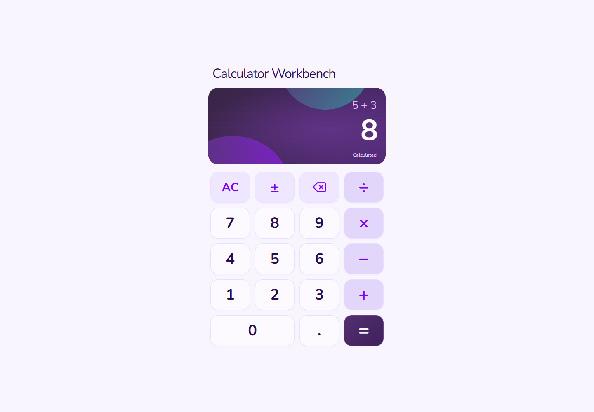

# Calculator Workbench

A small full-stack calculator with unusually careful interaction behavior. React and TypeScript own entry and keyboard state; a Go HTTP API evaluates arithmetic.



## Try it

Install Node.js 24 and Go 1.27, then run from the repository root:

```sh
npm run setup
npm run dev
```

Open <http://127.0.0.1:4512>. The launcher starts the API on loopback port 4511 and stops its own children on Ctrl+C. It checks occupied ports before starting. No account, database, or cloud service is required.

1. Enter `12 × 2 =` to get `24`.
2. Clear, then type `2 + 3 * 4 =` to get `20`. Chained operations evaluate left to right.
3. Try `8 ÷ 0 =`. Backspace, enter `2`, and retry to recover to `4`.

## Engineering choices

- A reducer models numeric entry, pending operations, loading, failures, and recovery. Keyboard and pointer input use the same transitions.
- The client preserves a failed calculation for retry and handles delayed or unavailable API responses.
- The Go service validates operands and operation names, rejects invalid requests, and uses bounded HTTP timeouts. It has no third-party runtime dependency.
- The responsive keypad has accessible names, pressed operator state, and a live result region.

`frontend/src/features/calculator` contains state, UI, and tests. `backend/internal/httpapi` contains the HTTP contract; `backend/cmd/server` owns configuration. Vite proxies `/api` locally. For a separate frontend origin, the API accepts an explicit `ALLOWED_ORIGIN`; avoid wildcard credentials policies.

## Verify

```sh
npm run verify
npm run format:check
```

The verifier runs Go tests, coverage, vet, and build, followed by frontend formatting, 85 tests, coverage, TypeScript checking, and a production build. Use `npm run format` and Go's `gofmt` when editing. CI repeats these checks.

## Project context

This is a refreshed portfolio edition of an earlier engineering exercise by Kallas Lima. The original submission is preserved separately. The current edition updates tooling, neutral branding, setup, documentation, and accessibility while retaining the actual calculator implementation and tests. This repository has no hosted deployment configured.
